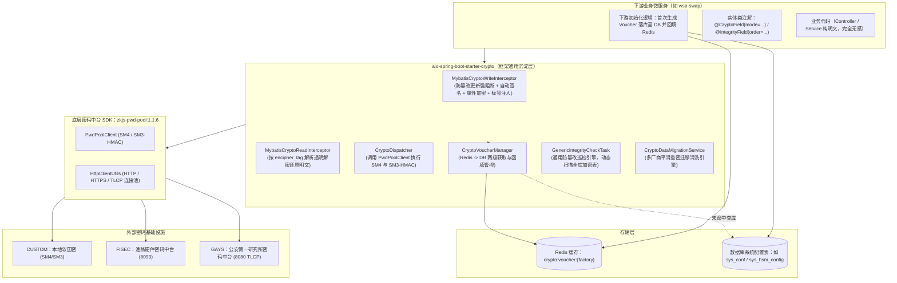

# aio-framework 国密加解密与防篡改统一 Starter 架构设计与实施规范

> **组件名称**：`aio-spring-boot-starter-crypto`  
> **底层依赖**：`com.zkjs.gm.pool:zkjs-pwd-pool:1.1.6`（中科嘉速密码资源池 SDK）  
> **框架适配**：`aio-framework:1.0.17`（基于 Spring Boot 3.x / 4.x、Java 21、MyBatis-Plus 3.5.x）  
> **核心原则**：
> 1. **Voucher 凭证两级获取与下游初始化**：Voucher 凭证首次由下游系统初始化保存至数据库并缓存到 Redis；后续获取优先从 Redis 取，未命中从 DB 查并回填 Redis；
> 2. **软国密（CUSTOM）密钥免配置**：与硬件凭证初始化流程完全一致，无需在配置文件中写死密钥，统一由两级存储管控；
> 3. **完整性签名算法默认 SM3_HMAC**：开箱即用，无需单独在配置文件中配置算法；
> 4. **巡检引擎精准状态流转**：严格遵循 `0: 未检查`、`1: 已检查正常`、`2: 数据已被篡改`，验签失败直接置 2 报警且写拦截强行阻断；
> 5. **敏感字段注解精简**：`@CryptoField` 仅提供 `mode` 单一属性（整段加密 vs 逐字符密文）。

---

## 目录

- [一、 总体架构与模块规划](#一-总体架构与模块规划)
- [二、 核心注解与实体约定规范](#二-核心注解与实体约定规范)
  - [2.1 @CryptoField（仅单属性 mode）](#21-cryptofield仅单属性-mode)
  - [2.2 @IntegrityField（防篡改字段排序）](#22-integrityfield防篡改字段排序)
  - [2.3 实体与数据库字段约定规范（0/1/2 状态流转）](#23-实体与数据库字段约定规范012-状态流转)
- [三、 密码凭证（Voucher）两级存储与下游初始化设计](#三-密码凭证voucher两级存储与下游初始化设计)
  - [3.1 凭证存储 SPI 设计（CryptoVoucherStorage）](#31-凭证存储-spi-设计cryptovoucherstorage)
  - [3.2 两级获取与回填机制（Redis -> DB -> 回填）](#32-两级获取与回填机制redis---db---回填)
  - [3.3 下游项目首次初始化与软国密密钥生成规范](#33-下游项目首次初始化与软国密密钥生成规范)
- [四、 密码资源池调度核心（对接 zkjs-pwd-pool）](#四-密码资源池调度核心对接-zkjs-pwd-pool)
  - [4.1 厂商枚举与历史别名兼容映射](#41-厂商枚举与历史别名兼容映射)
  - [4.2 SM4 加解密统一门面（Mode 0 / Mode 1）](#42-sm4-加解密统一门面mode-0--mode-1)
  - [4.3 数据完整性默认 SM3-HMAC 签名与验签](#43-数据完整性默认-sm3-hmac-签名与验签)
- [五、 MyBatis-Plus 透明拦截器设计](#五-mybatis-plus-透明拦截器设计)
  - [5.1 写拦截器（防篡改置0/阻断置2 + 自动签名 + 透明加密）](#51-写拦截器防篡改置0阻断置2--自动签名--透明加密)
  - [5.2 读拦截器（根据 encipher_tag 透明还原明文）](#52-读拦截器根据-encipher_tag-透明还原明文)
- [六、 通用防篡改巡检引擎（GenericIntegrityCheckTask）](#六-通用防篡改巡检引擎genericintegritychecktask)
  - [6.1 动态表发现机制（TableInfoHelper）](#61-动态表发现机制tableinfohelper)
  - [6.2 游标分页核验与 0/1/2 状态流转算法](#62-游标分页核验与-012-状态流转算法)
- [七、 生产级全量数据重密清洗迁移引擎](#七-生产级全量数据重密清洗迁移引擎)
- [八、 框架自动装配与配置规范（极简配置）](#八-框架自动装配与配置规范极简配置)
  - [8.1 极简 application.yml 规范](#81-极简-applicationyml-规范)
  - [8.2 Spring Boot 3/4 自动装配类](#82-spring-boot-34-自动装配类)
- [九、 业务工程（如 wsp-swap）接入与清理改造指南](#九-业务工程如-wsp-swap-接入与清理改造指南)

---

## 一、 总体架构与模块规划

### 1.1 模块依赖拓扑
在 `aio-framework` 根 `pom.xml` 中引入新 module：`<module>aio-spring-boot-starter-crypto</module>`。



### 1.2 模块 Maven 定义（`aio-spring-boot-starter-crypto/pom.xml`）
```xml
<?xml version="1.0" encoding="UTF-8"?>
<project xmlns="http://maven.apache.org/POM/4.0.0"
         xmlns:xsi="http://www.w3.org/2001/XMLSchema-instance"
         xsi:schemaLocation="http://maven.apache.org/POM/4.0.0 https://maven.apache.org/xsd/maven-4.0.0.xsd">
    <modelVersion>4.0.0</modelVersion>
    <parent>
        <groupId>com.zkjs.aio</groupId>
        <artifactId>aio-framework</artifactId>
        <version>${revision}</version>
    </parent>

    <artifactId>aio-spring-boot-starter-crypto</artifactId>
    <name>aio-spring-boot-starter-crypto</name>
    <description>企业级国密透明加解密、数据完整性防篡改与密码中台资源池统一组件</description>

    <dependencies>
        <!-- 1. 密码资源池统一 SDK -->
        <dependency>
            <groupId>com.zkjs.gm.pool</groupId>
            <artifactId>zkjs-pwd-pool</artifactId>
            <version>1.1.6</version>
        </dependency>

        <!-- 2. 框架通用组件（BusinessException 异常透传、统一响应、基础工具） -->
        <dependency>
            <groupId>com.zkjs.aio</groupId>
            <artifactId>aio-spring-boot-starter-common</artifactId>
        </dependency>

        <!-- 3. 框架持久层组件（MyBatis-Plus 拦截器支持与 TableInfoHelper） -->
        <dependency>
            <groupId>com.zkjs.aio</groupId>
            <artifactId>aio-spring-boot-starter-mybatis-plus</artifactId>
        </dependency>

        <!-- 4. 框架缓存组件（Redis 凭证缓存与激活厂商缓存） -->
        <dependency>
            <groupId>com.zkjs.aio</groupId>
            <artifactId>aio-spring-boot-starter-cache</artifactId>
        </dependency>
    </dependencies>
</project>
```

---

## 二、 核心注解与实体约定规范

### 2.1 `@CryptoField`（仅单属性 `mode`）
严格遵循精简规范，**仅提供一个属性**：配置整段加密和逐字符密文（默认整段加密）。无任何冗余参数！

```java
package com.zkjs.aio.crypto.annotation;

import com.zkjs.aio.crypto.enums.CryptoMode;

import java.lang.annotation.*;

/**
 * 敏感字段透明加解密注解
 * 仅包含单一属性 mode：配置加密模式（整段加密 vs 逐字符密文）
 *
 * @author wuyw
 */
@Target(ElementType.FIELD)
@Retention(RetentionPolicy.RUNTIME)
@Documented
public @interface CryptoField {

    /**
     * 加密模式：
     * - FULL: 整段密文（默认，调用 sm4Encrypt）
     * - CHAR_BY_CHAR: 逐字符密文（支持模糊搜索，调用拆分加密）
     */
    CryptoMode mode() default CryptoMode.FULL;
}
```

配套枚举 `CryptoMode.java`：
```java
package com.zkjs.aio.crypto.enums;

import lombok.Getter;

@Getter
public enum CryptoMode {
    /**
     * 0: 整段加密（调用 pwdPoolClient.sm4Encrypt / sm4Decrypt）
     */
    FULL(0, "整段加密"),

    /**
     * 1: 逐字符拆分加密（每个字符独立加密为 32-hex 密文后拼接，支持模糊匹配）
     */
    CHAR_BY_CHAR(1, "逐字符拆分加密");

    private final int mode;
    private final String desc;

    CryptoMode(int mode, String desc) {
        this.mode = mode;
        this.desc = desc;
    }

    public static CryptoMode of(int mode) {
        for (CryptoMode val : values()) {
            if (val.mode == mode) {
                return val;
            }
        }
        return FULL;
    }
}
```

### 2.2 `@IntegrityField`（防篡改字段排序）
```java
package com.zkjs.aio.crypto.annotation;

import java.lang.annotation.*;

/**
 * 数据完整性待签名字段注解
 * 拦截器按 order 升序读取字段值，以 |#| 分隔符有序拼接后调用国密 SM3-HMAC 算法计算签名
 *
 * @author wuyw
 */
@Target(ElementType.FIELD)
@Retention(RetentionPolicy.RUNTIME)
@Documented
public @interface IntegrityField {

    /**
     * 拼接排序序号，按升序严格排列
     */
    int order() default 0;

    /**
     * 属性为 null 时的默认占位符（避免由于 null 导致签名偏移）
     */
    String nullValue() default "";
}
```

### 2.3 实体与数据库字段约定规范（0/1/2 状态流转）
业务实体只需遵循约定提供对应物理列的属性（通过驼峰或 `@TableField` 映射）：

| 数据库物理列 | 实体属性名 | 类型 | 说明与流转规则 |
| :--- | :--- | :--- | :--- |
| `encipher_tag` | `encipherTag` | `String` | **加密标签**。由写拦截器自动生成注入。格式：`字段名:厂商:方式\|...`（如 `taskName:fisec:0\|sourceNode:plaintext:0`） |
| `sign_value` | `signValue` | `String` | **防篡改签名值**。入库/更新时基于待签字符串调用 `SM3_HMAC` 自动计算注入 |
| `data_tampered` | `dataTampered` | `Integer` | **篡改标识**。严格遵循状态机：<br/>• **`0` 未检查**：新增插入或更新后写拦截器自动重置为 0<br/>• **`1` 已检查正常**：巡检任务核验签名一致后置为 1<br/>• **`2` 数据已被篡改**：巡检任务核验签名不一致强制置为 2，写拦截器前置严禁更新！ |

---

## 三、 密码凭证（Voucher）两级存储与下游初始化设计

### 3.1 凭证存储 SPI 设计（CryptoVoucherStorage）
为了让下游项目自主控制数据库持久化（如存储在系统参数表、密码机配置表），框架提供通用 SPI 接口：

```java
package com.zkjs.aio.crypto.core;

/**
 * 密码机凭证（Voucher）数据库持久化扩展接口 (SPI)
 * 由下游业务工程实现或使用框架默认基于通用配置表的实现
 *
 * @author wuyw
 */
public interface CryptoVoucherStorage {

    /**
     * 从数据库查询指定厂商的 Voucher 凭证
     *
     * @param factory 厂商标识（custom / fisec / gays）
     * @return 凭证字符串（未找到返回 null）
     */
    String loadVoucherFromDb(String factory);

    /**
     * 将首次初始化的 Voucher 凭证保存到数据库
     *
     * @param factory 厂商标识（custom / fisec / gays）
     * @param voucher 凭证字符串
     */
    void saveVoucherToDb(String factory, String voucher);
}
```

> **框架默认实现**：若下游未显式声明该 Bean，框架提供默认的 `DefaultJdbcCryptoVoucherStorage`，自动读写通用系统配置表（如 `sys_conf` 或 `sys_hsm_config` 中的 `config_key = '{FACTORY}_PWD_VOUCHER'`）。

### 3.2 两级获取与回填机制（Redis -> DB -> 回填）
`CryptoVoucherManager` 严格按照“**优先 Redis -> 缓存未命中查 DB -> 回填写入 Redis**”的高性能高可用流水线工作：

```java
package com.zkjs.aio.crypto.core;

import com.zkjs.aio.cache.util.RedisUtil;
import com.zkjs.gm.pool.enums.PwdFactory;
import lombok.RequiredArgsConstructor;
import lombok.extern.slf4j.Slf4j;
import org.springframework.stereotype.Component;
import org.springframework.util.StringUtils;

/**
 * 密码机凭证（Voucher）管理器
 * 统一管理软国密（CUSTOM）、渔翁（FISEC）、公安一所（GAYS）凭证生命周期
 *
 * @author wuyw
 */
@Slf4j
@Component
@RequiredArgsConstructor
public class CryptoVoucherManager {

    private final CryptoVoucherStorage voucherStorage;

    public static final String VOUCHER_CACHE_PREFIX = "crypto:voucher:";

    /**
     * 获取指定密码厂商的有效操作凭证
     * 流水线：
     * 1. 优先从 Redis 获取；
     * 2. 若 Redis 缓存未命中，从数据库获取；
     * 3. 数据库获取成功后，立即回填写入 Redis 缓存；
     * 4. 若两级均不存在，抛出友好业务异常提示下游进行系统初始化。
     */
    public String getVoucher(PwdFactory factory) {
        String factoryName = factory.getFactoryName().toLowerCase();
        String cacheKey = VOUCHER_CACHE_PREFIX + factoryName;

        // 1. 优先查 Redis 缓存
        try {
            String cached = RedisUtil.get(cacheKey, String.class);
            if (StringUtils.hasText(cached)) {
                return cached;
            }
        } catch (Exception e) {
            log.warn("[Crypto Voucher] 读取 Redis 凭证缓存异常: {}", e.getMessage());
        }

        // 2. 缓存未命中，从数据库中查询
        log.info("[Crypto Voucher] Redis 凭证未命中，正在从数据库加载厂商 [{}] 凭证...", factoryName);
        String dbVoucher = voucherStorage.loadVoucherFromDb(factoryName);

        if (StringUtils.hasText(dbVoucher)) {
            // 3. 查到数据库凭证，立即回填 Redis
            try {
                RedisUtil.set(cacheKey, dbVoucher);
                log.info("[Crypto Voucher] 厂商 [{}] 凭证已从数据库加载并成功回填 Redis！", factoryName);
            } catch (Exception e) {
                log.warn("[Crypto Voucher] 回填 Redis 凭证异常: {}", e.getMessage());
            }
            return dbVoucher;
        }

        // 4. 两级均未找到，抛出异常提示下游系统初始化
        throw new IllegalStateException("【密码服务异常】未检测到密码厂商 [" + factoryName + "] 的有效凭证（Voucher）！" +
                "请检查下游初始化任务是否已执行，或联系安全管理员在系统配置中录入凭证。");
    }

    /**
     * 供下游初始化任务调用的保存接口：同时写入数据库与 Redis 缓存
     */
    public void saveAndCacheVoucher(PwdFactory factory, String voucher) {
        if (!StringUtils.hasText(voucher)) {
            throw new IllegalArgumentException("凭证内容不能为空！");
        }
        String factoryName = factory.getFactoryName().toLowerCase();
        // 1. 落库
        voucherStorage.saveVoucherToDb(factoryName, voucher);
        // 2. 写入 Redis
        String cacheKey = VOUCHER_CACHE_PREFIX + factoryName;
        RedisUtil.set(cacheKey, voucher);
        log.info("[Crypto Voucher] 厂商 [{}] 凭证已成功落库并缓存至 Redis！", factoryName);
    }
}
```

### 3.3 下游项目首次初始化与软国密密钥生成规范
在系统首次部署或首次切换厂商时，由下游项目执行一次初始化逻辑：

1. **硬件中台（FISEC / GAYS）初始化**：
   - 调用 SDK `pwdPoolClient.getVoucher(PwdFactory.FISEC)` 或 `getVoucher(PwdFactory.GAYS)`；
   - 调用 `voucherManager.saveAndCacheVoucher(...)` 保存至数据库并写入 Redis。
2. **自定义软国密（CUSTOM）初始化（免配置文件配置）**：
   - 彻底不再从 `application.yml` 中读取默认密钥；
   - 首次部署时，下游初始化逻辑生成随机 32 位 Hex 的 SM4 对称密钥及 SM2 密钥对（可通过 `pwdPoolClient.getCustomSm2PubAndPriKeys()` 获取），组装为：
     `Base64(SM4Key + "-" + SM2PrivateKey + "-" + SM2PublicKey)`
   - 调用 `voucherManager.saveAndCacheVoucher(PwdFactory.CUSTOM, customVoucher)` 写入数据库与 Redis；
   - **集群中的所有微服务节点启动时，自动从 Redis/DB 加载同一套 CUSTOM 密钥，确保多副本一致且无需配置**。

下游初始化示例代码（放置于下游项目的初始化 Runner 或管理接口中）：
```java
@Component
@RequiredArgsConstructor
@Slf4j
public class CryptoInitRunner implements ApplicationRunner {

    private final PwdPoolClient pwdPoolClient;
    private final CryptoVoucherManager voucherManager;

    @Override
    public void run(ApplicationArguments args) {
        // 检查并初始化软国密 CUSTOM 凭证
        initCustomIfAbsent();
    }

    private void initCustomIfAbsent() {
        try {
            voucherManager.getVoucher(PwdFactory.CUSTOM);
            log.info("[Crypto Init] 自定义软国密凭证已存在，无需重复初始化。");
        } catch (IllegalStateException e) {
            log.info("[Crypto Init] 首次启动，正在生成自定义软国密凭证...");
            // 1. 生成 16 字节随机 SM4 密钥（32 字符 Hex）
            String sm4Key = generateRandomHex32();
            // 2. 生成 SM2 密钥对
            Map<String, String> sm2Keys = pwdPoolClient.getCustomSm2PubAndPriKeys();
            String priKey = sm2Keys.get("PRIVATE_KEY");
            String pubKey = sm2Keys.get("PUBLIC_KEY");
            // 3. 按照 zkjs-pwd-pool 标准拼接格式并 Base64 编码
            String rawVoucher = sm4Key + "-" + priKey + "-" + pubKey;
            String customVoucher = Base64.getEncoder().encodeToString(rawVoucher.getBytes(StandardCharsets.UTF_8));
            // 4. 落库并同步 Redis
            voucherManager.saveAndCacheVoucher(PwdFactory.CUSTOM, customVoucher);
            log.info("[Crypto Init] 自定义软国密凭证初始化成功！");
        }
    }

    private String generateRandomHex32() {
        byte[] bytes = new byte[16];
        new SecureRandom().nextBytes(bytes);
        StringBuilder sb = new StringBuilder();
        for (byte b : bytes) {
            sb.append(String.format("%02x", b));
        }
        return sb.toString();
    }
}
```

---

## 四、 密码资源池调度核心（对接 zkjs-pwd-pool）

### 4.1 厂商枚举与历史别名兼容映射
```java
package com.zkjs.aio.crypto.core;

import com.zkjs.gm.pool.enums.PwdFactory;
import org.springframework.util.StringUtils;

public final class VendorMapper {

    public static PwdFactory toPwdFactory(String vendorCode) {
        if (!StringUtils.hasText(vendorCode)) {
            return PwdFactory.CUSTOM;
        }
        String lower = vendorCode.trim().toLowerCase();
        return switch (lower) {
            case "yuweng", "fisec" -> PwdFactory.FISEC;
            case "yisuo", "gays" -> PwdFactory.GAYS;
            default -> PwdFactory.CUSTOM;
        };
    }

    public static String toStandardCode(PwdFactory factory) {
        return factory != null ? factory.getFactoryName() : PwdFactory.CUSTOM.getFactoryName();
    }
}
```

### 4.2 SM4 加解密统一门面（Mode 0 / Mode 1）
### 4.3 数据完整性默认 SM3-HMAC 签名与验签
```java
package com.zkjs.aio.crypto.core;

import com.zkjs.aio.cache.util.RedisUtil;
import com.zkjs.aio.crypto.config.AioCryptoProperties;
import com.zkjs.aio.crypto.enums.CryptoMode;
import com.zkjs.gm.pool.PwdPoolClient;
import com.zkjs.gm.pool.enums.PwdFactory;
import lombok.RequiredArgsConstructor;
import lombok.extern.slf4j.Slf4j;
import org.springframework.stereotype.Component;
import org.springframework.util.StringUtils;

import java.nio.charset.StandardCharsets;
import java.util.Base64;

@Slf4j
@Component
@RequiredArgsConstructor
public class CryptoDispatcher {

    private final PwdPoolClient pwdPoolClient;
    private final CryptoVoucherManager voucherManager;
    private final AioCryptoProperties properties;

    public static final String ACTIVE_VENDOR_REDIS_KEY = "crypto:active_vendor";
    private static final int SPLIT_HEX_LEN = 32;

    /**
     * 获取当前系统全局激活的密码厂商（优先 Redis，回退配置项）
     */
    public PwdFactory getActiveFactory() {
        try {
            String code = RedisUtil.get(ACTIVE_VENDOR_REDIS_KEY, String.class);
            if (StringUtils.hasText(code)) {
                return VendorMapper.toPwdFactory(code);
            }
        } catch (Exception ignored) {
        }
        return VendorMapper.toPwdFactory(properties.getActiveVendor());
    }

    /**
     * 解析凭证中的 SM4 对称密钥（软国密解出第一段，硬加密直接返回 Voucher）
     */
    private String resolveSm4Key(PwdFactory factory, String voucher) {
        if (factory == PwdFactory.CUSTOM) {
            String decoded = new String(Base64.getDecoder().decode(voucher), StandardCharsets.UTF_8);
            return decoded.split("-")[0];
        }
        return voucher;
    }

    // =========================================================================
    // 1. SM4 加密（对接 zkjs-pwd-pool）
    // =========================================================================
    public String encrypt(String plainText, PwdFactory factory, CryptoMode mode) {
        if (!StringUtils.hasText(plainText)) {
            return plainText;
        }
        PwdFactory target = factory != null ? factory : getActiveFactory();
        String voucher = voucherManager.getVoucher(target);
        String sm4Key = resolveSm4Key(target, voucher);

        try {
            if (mode == CryptoMode.CHAR_BY_CHAR) {
                // 逐字符拆分加密：每个单字符调用 SM4 CBC 生成 32-hex 密文后拼接
                StringBuilder sb = new StringBuilder();
                for (char c : plainText.toCharArray()) {
                    sb.append(pwdPoolClient.sm4Encrypt(sm4Key, String.valueOf(c), target));
                }
                return sb.toString();
            } else {
                // 整段加密
                return pwdPoolClient.sm4Encrypt(sm4Key, plainText, target);
            }
        } catch (Exception e) {
            log.error("[CryptoDispatcher] SM4 加密失败: vendor={}, mode={}, err={}", target, mode, e.getMessage(), e);
            throw new RuntimeException("数据国密加密异常: " + e.getMessage(), e);
        }
    }

    public String encrypt(String plainText, CryptoMode mode) {
        return encrypt(plainText, getActiveFactory(), mode);
    }

    // =========================================================================
    // 2. SM4 解密（对接 zkjs-pwd-pool）
    // =========================================================================
    public String decrypt(String cipherText, PwdFactory factory, CryptoMode mode) {
        if (!StringUtils.hasText(cipherText)) {
            return cipherText;
        }
        PwdFactory target = factory != null ? factory : getActiveFactory();
        String voucher = voucherManager.getVoucher(target);
        String sm4Key = resolveSm4Key(target, voucher);

        try {
            if (mode == CryptoMode.CHAR_BY_CHAR) {
                // 逐字符拆分解密：按 32-hex 步长切片后分别调用 sm4Decrypt
                StringBuilder sb = new StringBuilder();
                for (int i = 0; i < cipherText.length(); i += SPLIT_HEX_LEN) {
                    String chunk = cipherText.substring(i, Math.min(i + SPLIT_HEX_LEN, cipherText.length()));
                    sb.append(pwdPoolClient.sm4Decrypt(sm4Key, chunk, target));
                }
                return sb.toString();
            } else {
                // 整段解密
                return pwdPoolClient.sm4Decrypt(sm4Key, cipherText, target);
            }
        } catch (Exception e) {
            log.warn("[CryptoDispatcher] SM4 解密失败，返回原值: vendor={}, err={}", target, e.getMessage());
            return cipherText;
        }
    }

    // =========================================================================
    // 3. 数据完整性防篡改：默认且固定采用 SM3-HMAC
    // =========================================================================
    /**
     * 计算数据完整性签名（国密 SM3-HMAC，无需单独配置算法）
     */
    public String sign(String plainContent, PwdFactory factory) {
        if (!StringUtils.hasText(plainContent)) {
            return "";
        }
        PwdFactory target = factory != null ? factory : getActiveFactory();
        String voucher = voucherManager.getVoucher(target);
        String hmacKey = resolveSm4Key(target, voucher);

        try {
            return pwdPoolClient.sm3Hmac(hmacKey, plainContent, target);
        } catch (Exception e) {
            log.error("[CryptoDispatcher] SM3-HMAC 签名计算异常: vendor={}, err={}", target, e.getMessage());
            throw new RuntimeException("SM3-HMAC 签名计算失败: " + e.getMessage(), e);
        }
    }

    public String sign(String plainContent) {
        return sign(plainContent, getActiveFactory());
    }

    /**
     * 校验数据完整性（国密 SM3-HMAC 比对）
     */
    public boolean verify(String plainContent, String signValue, PwdFactory factory) {
        if (!StringUtils.hasText(plainContent) || !StringUtils.hasText(signValue)) {
            return false;
        }
        PwdFactory target = factory != null ? factory : getActiveFactory();
        String expectedHmac = sign(plainContent, target);
        return signValue.equalsIgnoreCase(expectedHmac);
    }

    public boolean verify(String plainContent, String signValue) {
        return verify(plainContent, signValue, getActiveFactory());
    }
}
```

---

## 五、 MyBatis-Plus 透明拦截器设计

### 5.1 写拦截器（防篡改置0/阻断置2 + 自动签名 + 透明加密）
拦截 `Executor.update`，严格执行防篡改与加解密生命周期：
1. **【防篡改强阻断（置2检查）】**：若当前操作为 `UPDATE`，前置查询数据库当前记录的 `data_tampered`。若为 **`2`（已篡改）**，直接抛出 `BusinessException`，禁止修改！
2. **【自动签名与状态置0】**：
   - 按 `@IntegrityField(order=...)` 顺序拼接明文字段为 `|#|` 待签字符串；
   - 调用 `dispatcher.sign(plainContent)` 计算当前激活厂商的 `SM3_HMAC` 签名写入 `sign_value`；
   - **将 `data_tampered` 初始化或重置为 `0`（未检查）**。
3. **【透明加密与标签注入】**：
   - 提取所有标注 `@CryptoField` 的字段，依据其 `mode` 调用 SM4 加密；
   - 自动组装 `encipher_tag`（格式如 `fieldName:vendor:mode|...`）注入实体；
4. **【内存自动还原（防污染）】**：
   - 在 `finally` 块中立即将实体内存属性还原为原始明文，确保 Controller/Service 的实体纯净。

```java
package com.zkjs.aio.crypto.interceptor;

import com.baomidou.mybatisplus.annotation.TableName;
import com.zkjs.aio.common.exception.BusinessException;
import com.zkjs.aio.crypto.core.CryptoDispatcher;
import com.zkjs.aio.crypto.core.VendorMapper;
import com.zkjs.aio.crypto.envelope.EncipherTagHelper;
import com.zkjs.aio.crypto.envelope.IntegrityHelper;
import lombok.RequiredArgsConstructor;
import lombok.extern.slf4j.Slf4j;
import org.apache.ibatis.executor.Executor;
import org.apache.ibatis.mapping.MappedStatement;
import org.apache.ibatis.mapping.SqlCommandType;
import org.apache.ibatis.plugin.*;
import org.springframework.jdbc.core.JdbcTemplate;
import org.springframework.stereotype.Component;

import java.lang.reflect.Field;
import java.util.*;

@Slf4j
@Component
@RequiredArgsConstructor
@Intercepts({
        @Signature(type = Executor.class, method = "update", args = {MappedStatement.class, Object.class})
})
public class MybatisCryptoWriteInterceptor implements Interceptor {

    private final CryptoDispatcher dispatcher;
    private final JdbcTemplate jdbcTemplate;

    @Override
    public Object intercept(Invocation invocation) throws Throwable {
        MappedStatement ms = (MappedStatement) invocation.getArgs()[0];
        Object parameterObject = invocation.getArgs()[1];
        SqlCommandType commandType = ms.getSqlCommandType();

        List<RestoreAction> restoreActions = new ArrayList<>();
        Set<Object> visited = Collections.newSetFromMap(new IdentityHashMap<>());
        try {
            if (parameterObject != null) {
                processObject(parameterObject, commandType, restoreActions, visited);
            }
            return invocation.proceed();
        } finally {
            // 物理入库完成后，立即将内存属性还原为原始明文
            for (int i = restoreActions.size() - 1; i >= 0; i--) {
                restoreActions.get(i).restore();
            }
        }
    }

    private void processObject(Object param, SqlCommandType commandType, List<RestoreAction> restoreActions, Set<Object> visited) {
        if (param == null || !visited.add(param)) return;
        if (param instanceof Map<?, ?> map) {
            for (Object val : map.values()) processObject(val, commandType, restoreActions, visited);
        } else if (param instanceof Collection<?> col) {
            for (Object item : col) processObject(item, commandType, restoreActions, visited);
        } else {
            handleEntity(param, commandType, restoreActions);
        }
    }

    private void handleEntity(Object entity, SqlCommandType commandType, List<RestoreAction> restoreActions) {
        if (entity == null) return;

        // 1. 完整性防篡改检查与签名更新
        handleIntegrity(entity, commandType);

        // 2. 敏感数据透明加密
        handleEncryption(entity, restoreActions);
    }

    private void handleIntegrity(Object entity, SqlCommandType commandType) {
        if (!IntegrityMetadataCache.hasIntegrityFields(entity.getClass())) return;

        // 若为 UPDATE 操作，前置强校验当前记录是否已被标记为篡改
        if (commandType == SqlCommandType.UPDATE) {
            Field idField = IntegrityMetadataCache.getIdField(entity.getClass());
            if (idField != null) {
                try {
                    Object idVal = idField.get(entity);
                    if (idVal != null) {
                        checkTamperStatus(entity.getClass(), idVal);
                    }
                } catch (BusinessException be) {
                    throw be;
                } catch (Exception e) {
                    log.warn("[Crypto Integrity] 读取 ID 字段异常: {}", e.getMessage());
                }
            }
        }

        // 拼接待签明文并计算 SM3-HMAC 签名
        String plainContent = IntegrityHelper.buildPlainString(entity);
        if (plainContent != null) {
            String sign = dispatcher.sign(plainContent);
            Field signField = IntegrityMetadataCache.getSignField(entity.getClass());
            if (signField != null) {
                try {
                    signField.set(entity, sign);
                } catch (Exception ignored) {}
            }

            // 新增或更新操作：将 data_tampered 强制重置为 0（未检查）
            Field statusField = IntegrityMetadataCache.getStatusField(entity.getClass());
            if (statusField != null) {
                try {
                    statusField.set(entity, 0);
                } catch (Exception ignored) {}
            }
        }
    }

    private void checkTamperStatus(Class<?> entityClass, Object idVal) {
        String tableName = getTableName(entityClass);
        String sql = "SELECT data_tampered FROM " + tableName + " WHERE id = ?";
        try {
            List<Integer> list = jdbcTemplate.query(sql, (rs, rowNum) -> rs.getInt("data_tampered"), idVal);
            if (!list.isEmpty() && Integer.valueOf(2).equals(list.get(0))) {
                // 篡改标识为 2 时严禁更新，抛出 BusinessException 由 common 自动穿透返回前端
                String msg = "【操作禁止】当前记录 [ID=" + idVal + "] 数据已被篡改（data_tampered=2），系统已锁定，严禁更新！请联系安全管理员核查。";
                log.error("[Crypto Integrity] 拦截到对已篡改数据的修改操作: table={}, id={}", tableName, idVal);
                throw BusinessException.of(msg);
            }
        } catch (BusinessException be) {
            throw be;
        } catch (Exception e) {
            log.warn("[Crypto Integrity] 检查数据库防篡改状态失败: table={}, id={}, err={}", tableName, idVal, e.getMessage());
        }
    }

    private void handleEncryption(Object entity, List<RestoreAction> restoreActions) {
        List<CryptoMetadataCache.CryptoFieldMeta> metas = CryptoMetadataCache.getCryptoFields(entity.getClass());
        if (metas.isEmpty()) return;

        List<EncipherTagHelper.TagItem> tagItems = new ArrayList<>();
        String currentVendor = VendorMapper.toStandardCode(dispatcher.getActiveFactory());

        for (CryptoMetadataCache.CryptoFieldMeta meta : metas) {
            Field field = meta.getField();
            var mode = meta.getAnnotation().mode();
            try {
                Object val = field.get(entity);
                if (val instanceof String plainText && !plainText.isEmpty()) {
                    String cipher = dispatcher.encrypt(plainText, mode);
                    restoreActions.add(new RestoreAction(field, entity, plainText));
                    field.set(entity, cipher);
                    tagItems.add(new EncipherTagHelper.TagItem(field.getName(), currentVendor, mode.getMode()));
                } else {
                    tagItems.add(new EncipherTagHelper.TagItem(field.getName(), EncipherTagHelper.VENDOR_PLAINTEXT, mode.getMode()));
                }
            } catch (Exception e) {
                log.error("[Crypto Write] 字段加密拦截失败: entity={}, field={}", entity.getClass().getSimpleName(), field.getName(), e);
                tagItems.add(new EncipherTagHelper.TagItem(field.getName(), EncipherTagHelper.VENDOR_PLAINTEXT, mode.getMode()));
            }
        }

        // 自动注入 encipherTag
        Field tagField = CryptoMetadataCache.getTagField(entity.getClass());
        if (tagField != null) {
            try {
                tagField.set(entity, EncipherTagHelper.buildTag(tagItems));
            } catch (Exception ignored) {}
        }
    }

    private String getTableName(Class<?> clazz) {
        TableName tn = clazz.getAnnotation(TableName.class);
        return (tn != null && !tn.value().isEmpty()) ? tn.value() : clazz.getSimpleName().toLowerCase();
    }

    private record RestoreAction(Field field, Object target, String originalPlainText) {
        public void restore() {
            try {
                field.set(target, originalPlainText);
            } catch (Exception ignored) {}
        }
    }
}
```

### 5.2 读拦截器（根据 encipher_tag 透明还原明文）
拦截 `ResultSetHandler.handleResultSets`，提取实体结果：
1. 读取实体中的 `encipherTag` 字符串，反序列化为每个字段的加密元数据（`TagItem`）；
2. 逐字段识别：若标注为 `plaintext`，原样跳过；若为密文，依据 `TagItem.vendor()`（兼容旧 `yuweng/yisuo`）与 `TagItem.mode()` 调用 `dispatcher.decrypt(...)` 透明还原为明文。

---

## 六、 通用防篡改巡检引擎（GenericIntegrityCheckTask）

### 6.1 动态表发现机制（TableInfoHelper）
巡检引擎彻底解耦业务表，在启动后和执行定时任务时，通过 MyBatis-Plus `TableInfoHelper.getTableInfos()` 动态扫描所有注册实体：
1. 提取所有包含 `@IntegrityField` 的实体表；
2. 动态读取该实体的表名（`tableName`）、主键字段（`keyColumn`）、防篡改状态列名（`data_tampered`）与签名列名（`sign_value`）；
3. 任何业务工程的任何表只要添加了注解，框架全自动纳入巡检，无需修改任何代码。

### 6.2 游标分页核验与 0/1/2 状态流转算法
```java
package com.zkjs.aio.crypto.task;

import com.baomidou.mybatisplus.core.metadata.TableInfo;
import com.baomidou.mybatisplus.core.metadata.TableInfoHelper;
import com.zkjs.aio.crypto.core.CryptoDispatcher;
import com.zkjs.aio.crypto.envelope.IntegrityHelper;
import com.zkjs.aio.crypto.interceptor.IntegrityMetadataCache;
import lombok.Builder;
import lombok.Data;
import lombok.RequiredArgsConstructor;
import lombok.extern.slf4j.Slf4j;
import org.apache.ibatis.session.SqlSession;
import org.apache.ibatis.session.SqlSessionFactory;
import org.springframework.jdbc.core.JdbcTemplate;
import org.springframework.scheduling.annotation.Scheduled;
import org.springframework.stereotype.Component;
import org.springframework.util.StringUtils;

import java.lang.reflect.Field;
import java.util.*;

/**
 * 通用防篡改巡检引擎
 * 目标：
 * 1. 动态扫描所有带 @IntegrityField 的表；
 * 2. 游标分页核验 SM3-HMAC 签名是否一致；
 * 3. 严格维护篡改标识（0 未检查，1 已检查正常，2 数据已被篡改）；
 * 4. 发现篡改（验签不通过）时将标识更新为 2，并输出严重安全告警。
 *
 * @author wuyw
 */
@Slf4j
@Component
@RequiredArgsConstructor
public class GenericIntegrityCheckTask {

    private final CryptoDispatcher dispatcher;
    private final JdbcTemplate jdbcTemplate;
    private final SqlSessionFactory sqlSessionFactory;

    private static final int PAGE_SIZE = 200;

    /**
     * 默认每 30 分钟定时触发巡检
     */
    @Scheduled(cron = "${aio.crypto.integrity.cron:0 */30 * * * ?}")
    public void scheduledCheck() {
        log.info("===> [防篡改巡检] 触发定时全局数据完整性巡检任务...");
        executeAll();
    }

    /**
     * 全局巡检入口（可供定时任务或管理员 REST 接口手动触发）
     */
    public List<IntegrityReport> executeAll() {
        List<IntegrityReport> reports = new ArrayList<>();
        Collection<TableInfo> tableInfos = TableInfoHelper.getTableInfos();

        for (TableInfo tableInfo : tableInfos) {
            Class<?> entityClass = tableInfo.getEntityType();
            if (IntegrityMetadataCache.hasIntegrityFields(entityClass)) {
                reports.add(inspectSingleTable(tableInfo, entityClass));
            }
        }
        return reports;
    }

    /**
     * 针对单个表执行完整性巡检
     */
    public IntegrityReport inspectSingleTable(TableInfo tableInfo, Class<?> entityClass) {
        long start = System.currentTimeMillis();
        String tableName = tableInfo.getTableName();
        String idCol = tableInfo.getKeyColumn();
        if (!StringUtils.hasText(idCol)) {
            idCol = "id";
        }

        Field idField = IntegrityMetadataCache.getIdField(entityClass);
        Field signField = IntegrityMetadataCache.getSignField(entityClass);
        Field statusField = IntegrityMetadataCache.getStatusField(entityClass);

        log.info("===> [防篡改巡检] 开始巡检表 [{}] (实体: {})", tableName, entityClass.getSimpleName());

        long lastId = 0L;
        int totalChecked = 0;
        int normalCount = 0;
        int tamperedCount = 0;

        String selectSql = String.format("SELECT * FROM %s WHERE %s > ? ORDER BY %s ASC LIMIT %d",
                tableName, idCol, idCol, PAGE_SIZE);

        while (true) {
            // 通过 SqlSession 查询以确保经过 MyBatis 读拦截器（密文字段已被解密为明文）
            List<?> records = queryEntityBatch(entityClass, selectSql, lastId);
            if (records.isEmpty()) {
                break;
            }

            for (Object entity : records) {
                totalChecked++;
                Object idVal = extractVal(idField, entity);
                if (idVal instanceof Number num) {
                    lastId = num.longValue();
                }

                String currentSign = (String) extractVal(signField, entity);
                Integer currentStatus = (Integer) extractVal(statusField, entity);

                // 1. 按 @IntegrityField 顺序拼接明文字段
                String plainContent = IntegrityHelper.buildPlainString(entity);

                // 2. 调用当前激活密码厂商进行 SM3-HMAC 验签
                boolean isValid = false;
                if (plainContent != null && StringUtils.hasText(currentSign)) {
                    isValid = dispatcher.verify(plainContent, currentSign);
                }

                // 3. 严格依据验签结果维护篡改状态：0 未检查，1 正常，2 篡改
                if (!isValid) {
                    tamperedCount++;
                    log.error("【重大安全告警】检测到表 [{}] 记录 [ID={}] 数据已被篡改！库内原签名={}",
                            tableName, idVal, currentSign);
                    // 篡改标识更新为 2
                    jdbcTemplate.update("UPDATE " + tableName + " SET data_tampered = 2 WHERE " + idCol + " = ?", idVal);
                } else {
                    normalCount++;
                    // 验签通过：若状态尚未置为 1，则将其置为 1（已检查正常）
                    if (currentStatus == null || currentStatus != 1) {
                        jdbcTemplate.update("UPDATE " + tableName + " SET data_tampered = 1 WHERE " + idCol + " = ?", idVal);
                    }
                }
            }
        }

        long cost = System.currentTimeMillis() - start;
        log.info("===> [防篡改巡检] 表 [{}] 巡检完成！核查: {}，正常: {}，篡改: {}，耗时: {} ms",
                tableName, totalChecked, normalCount, tamperedCount, cost);

        return IntegrityReport.builder()
                .tableName(tableName)
                .totalChecked(totalChecked)
                .normalCount(normalCount)
                .tamperedCount(tamperedCount)
                .costMs(cost)
                .build();
    }

    private List<?> queryEntityBatch(Class<?> entityClass, String sql, long lastId) {
        try (SqlSession session = sqlSessionFactory.openSession()) {
            return session.selectList(entityClass.getName() + ".selectListByCursor", lastId);
        } catch (Exception e) {
            return queryByJdbcFallback(entityClass, sql, lastId);
        }
    }

    private List<?> queryByJdbcFallback(Class<?> clazz, String sql, long lastId) {
        return jdbcTemplate.query(sql, (rs, rowNum) -> {
            try {
                Object instance = clazz.getDeclaredConstructor().newInstance();
                // 通用 JDBC 查询映射回退
                return instance;
            } catch (Exception ex) {
                return null;
            }
        }, lastId);
    }

    private Object extractVal(Field field, Object target) {
        if (field == null || target == null) return null;
        try {
            return field.get(target);
        } catch (Exception e) {
            return null;
        }
    }

    @Data
    @Builder
    public static class IntegrityReport {
        private String tableName;
        private int totalChecked;
        private int normalCount;
        private int tamperedCount;
        private long costMs;
    }
}
```

---

## 七、 生产级全量数据重密清洗迁移引擎

在更换硬件密码机（如自定义软国密切换为渔翁密码中台，或渔翁切换为一所密码中台）时，通过 `CryptoDataMigrationService` 执行全量重密清洗：
- **旧厂商解密**：按照当前 `encipher_tag` 中的旧厂商解析并解密历史密文；
- **新厂商加密**：调用新厂商的 SM4 加密算法，重新计算并写入新 `encipher_tag`；
- **重签与重置**：调用新厂商算法重新计算防篡改签名 `sign_value`（SM3-HMAC），并将 `data_tampered` 重置为 `0`；
- **游标分页与单批事务**：单批次 500 条独立事务提交，遇中断支持断点续跑。

---

## 八、 框架自动装配与配置规范（极简配置）

### 8.1 极简 application.yml 规范
配置文件中**彻底剔除**了软国密密钥配置与签名算法配置，配置极其干净利落：

```yaml
# ===================================================================
# 框架国密透明加解密与防篡改统一配置（极简配置）
# ===================================================================
aio:
  crypto:
    enabled: true
    # 全局默认激活密码厂商：custom (软国密), fisec (渔翁), gays (公安一所)
    active-vendor: custom
    # 数据完整性防篡改巡检配置（签名算法默认且固定为 SM3_HMAC，无需单独配置）
    integrity:
      enabled: true
      # 定时巡检 Cron 表达式（默认每 30 分钟一次）
      cron: "0 */30 * * * ?"

# ===================================================================
# zkjs-pwd-pool 官方资源池网络配置（原生对齐 SDK）
# ===================================================================
gm:
  default-pwd-factory: custom
  fisec:
    pwd-pool:
      enable: false
      protocol: https
      host: 10.3.4.103
      port: 8093
      user-name: app01
      user-pwd: Aa12345678!
      request-id: "000001"
      token-timeout: 30
  gays:
    pwd-pool:
      enable: false
      protocol: http
      is-tlcp: false
      host: 10.3.4.105
      port: 8080
      app-key: ak_000001
      secret-key: sk_1234567890abcdef
      app-id: app_000001

http-client:
  connect-timeout: 10
  read-timeout: 10
  connection-request-timeout: 10
  max-total-connections: 200
  max-connections-per-route: 50
  keep-alive-duration: 5
  validate-after-inactivity: 2000
```

### 8.2 Spring Boot 3/4 自动装配类
`aio-spring-boot-starter-crypto/src/main/resources/META-INF/spring/org.springframework.boot.autoconfigure.AutoConfiguration.imports`：
```properties
com.zkjs.aio.crypto.config.AioCryptoAutoConfiguration
```

`AioCryptoAutoConfiguration.java`：
```java
package com.zkjs.aio.crypto.config;

import com.zkjs.aio.crypto.core.*;
import com.zkjs.aio.crypto.interceptor.MybatisCryptoReadInterceptor;
import com.zkjs.aio.crypto.interceptor.MybatisCryptoWriteInterceptor;
import com.zkjs.aio.crypto.task.GenericIntegrityCheckTask;
import com.zkjs.gm.pool.PwdPoolClient;
import com.zkjs.gm.pool.util.HttpClientUtils;
import org.apache.ibatis.session.SqlSessionFactory;
import org.springframework.boot.autoconfigure.AutoConfiguration;
import org.springframework.boot.autoconfigure.condition.ConditionalOnMissingBean;
import org.springframework.boot.autoconfigure.condition.ConditionalOnProperty;
import org.springframework.boot.context.properties.EnableConfigurationProperties;
import org.springframework.context.annotation.Bean;
import org.springframework.jdbc.core.JdbcTemplate;

import javax.annotation.PostConstruct;
import javax.annotation.PreDestroy;

@AutoConfiguration
@ConditionalOnProperty(prefix = "aio.crypto", name = "enabled", havingValue = "true", matchIfMissing = true)
@EnableConfigurationProperties(AioCryptoProperties.class)
public class AioCryptoAutoConfiguration {

    @PostConstruct
    public void initHttpClient(AioCryptoProperties props) {
        HttpClientUtils.init(props.buildHttpClientParams());
    }

    @PreDestroy
    public void destroyHttpClient() {
        HttpClientUtils.destroy();
    }

    @Bean
    @ConditionalOnMissingBean
    public PwdPoolClient pwdPoolClient(AioCryptoProperties props) {
        return props.buildPwdPoolClient();
    }

    @Bean
    @ConditionalOnMissingBean
    public CryptoVoucherStorage cryptoVoucherStorage(JdbcTemplate jdbcTemplate) {
        return new DefaultJdbcCryptoVoucherStorage(jdbcTemplate);
    }

    @Bean
    @ConditionalOnMissingBean
    public CryptoVoucherManager cryptoVoucherManager(CryptoVoucherStorage storage) {
        return new CryptoVoucherManager(storage);
    }

    @Bean
    @ConditionalOnMissingBean
    public CryptoDispatcher cryptoDispatcher(PwdPoolClient client, CryptoVoucherManager voucherManager, AioCryptoProperties props) {
        return new CryptoDispatcher(client, voucherManager, props);
    }

    @Bean
    @ConditionalOnMissingBean
    public MybatisCryptoWriteInterceptor mybatisCryptoWriteInterceptor(CryptoDispatcher dispatcher, JdbcTemplate jdbcTemplate) {
        return new MybatisCryptoWriteInterceptor(dispatcher, jdbcTemplate);
    }

    @Bean
    @ConditionalOnMissingBean
    public MybatisCryptoReadInterceptor mybatisCryptoReadInterceptor(CryptoDispatcher dispatcher) {
        return new MybatisCryptoReadInterceptor(dispatcher);
    }

    @Bean
    @ConditionalOnMissingBean
    @ConditionalOnProperty(prefix = "aio.crypto.integrity", name = "enabled", havingValue = "true", matchIfMissing = true)
    public GenericIntegrityCheckTask genericIntegrityCheckTask(CryptoDispatcher dispatcher, JdbcTemplate jdbcTemplate, SqlSessionFactory sessionFactory) {
        return new GenericIntegrityCheckTask(dispatcher, jdbcTemplate, sessionFactory);
    }
}
```

---

## 九、 业务工程（如 wsp-swap）接入与清理改造指南

在 `aio-spring-boot-starter-crypto` 下沉完毕后，业务微服务接入仅需 **3 个极简步骤**：

### 9.1 第一步：引入 Starter 依赖
修改业务工程 `pom.xml`：
```xml
<dependency>
    <groupId>com.zkjs.aio</groupId>
    <artifactId>aio-spring-boot-starter-crypto</artifactId>
    <version>1.0.17</version>
</dependency>
```

### 9.2 第二步：彻底清理业务工程冗余代码
1. **删除本地包**：彻底删除 `com.zkjs.aio.swap.crypto` 整个包及其下所有类（拦截器、调度器、巡检任务、适配器实现类等 20 多个文件）；
2. **实体类换包引入**：
   ```java
   import com.zkjs.aio.crypto.annotation.CryptoField;
   import com.zkjs.aio.crypto.annotation.IntegrityField;
   import com.zkjs.aio.crypto.enums.CryptoMode;

   public class SwapTask {
       // 敏感字段加密（默认整段密文）
       @CryptoField
       private String taskName;

       // 逐字符密文（支持模糊搜索）
       @CryptoField(mode = CryptoMode.CHAR_BY_CHAR)
       private String sourceNode;

       // 防篡改顺序字段
       @IntegrityField(order = 1)
       private Long id;

       @IntegrityField(order = 2)
       private String taskName;

       // 约定框架列
       private String encipherTag;
       private String signValue;
       private Integer dataTampered; // 0 未检查，1 正常，2 篡改
   }
   ```
3. **编写系统首次凭证初始化 Runner**（或提供管理端页面触发首次中台登录与落库）：
   - 首次部署执行一次：将获取/生成的凭证落库至数据库并缓存至 Redis；后续运行全自动两级命中。

### 9.3 第三步：运行验证收益
1. **统一异常穿透**：当有被篡改数据（`data_tampered == 2`）尝试更新时，写拦截器自动抛出 `BusinessException`，`aio-spring-boot-starter-common` 框架异常处理器自动解包穿透，向前端返回清晰阻断提示；
2. **零业务侵入**：业务 Controller / Service 100% 处理纯明文，完全不需要感知底层密码硬件和网络通信；
3. **巡检全自动化**：系统每 30 分钟自动对全库防篡改表进行核验，状态在 `0 -> 1` 或 `0 -> 2` 之间精准流转；
4. **两级缓存保障性能**：Voucher 凭证常驻 Redis 内存，零频次访问中台凭证接口，断电/重启可自愈从 DB 回填。
